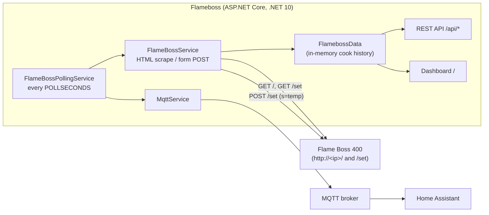

# Flame Boss Local Controller

A self-hosted replacement for the Flame Boss phone app, for the
[Flame Boss 400 WiFi Smoker Controller](https://www.flameboss.com/product/flame-boss-400-wifi-smoker-controller-kit-universal/).

It talks directly to the controller's built-in web page on your LAN (no Flame Boss cloud account or app needed) and gives you:

- **Web dashboard** (Blazor + MudBlazor): live pit, meat, set-point, and blower readings, plus time-series charts for the current cook.
- **REST API**: read status, set the pit target temperature, start/stop a cook, health checks.
- **Home Assistant via MQTT**: publishes sensor state and auto-discovery config so the controller shows up as a device in Home Assistant.

## How it works



The Flame Boss 400 serves a plain HTML page on its local IP:

| Device URL | Used for |
|---|---|
| `GET /` | Pit temperature, blower %, Meat 1 temperature (parsed from the HTML tables) |
| `GET /set` | Current set temperature (value of the `s` form field) |
| `POST /set` with form field `s=<temp>` | Change the set temperature |

Sample captures of both pages are in `Flameboss/output.html` and `Flameboss/set.html`.

### Cook sessions

Polling only happens while a cook is active. Start/stop a cook with the dashboard's **Toggle Cook** button or `GET /api/toggle-cook`.

- Starting a cook clears history, takes an immediate reading, then polls every `POLLSECONDS`.
- Each reading is appended to the in-memory history that feeds the charts, and is published to MQTT.
- Stopping a cook clears the history.
- Cook state and history live only in memory and are lost when the app restarts.

## Configuration

All settings come from environment variables. **Set all of them**; the defaults in `Configuration.cs` are overwritten by the environment values, even when a variable is unset.

| Variable | Example | Notes |
|---|---|---|
| `FLAMEBOSSURL` | `http://192.168.1.178/` | Controller base URL. **Must end with `/`**, because `set` is appended directly. |
| `MQTTBROKER` | `192.168.1.102` | MQTT broker host (default port 1883). Falls back to `localhost` if unset. |
| `MQTTUSERNAME` | `mqtt` | MQTT username. |
| `MQTTPASSWORD` | | MQTT password. |
| `DEVICENAME` | `flameboss_bbq` | Home Assistant device identifier. |
| `FRIENDLYNAME` | `Flame Boss BBQ` | Home Assistant device name and sensor name prefix. |
| `POLLSECONDS` | `5` | Poll interval. **Required**: if unset it becomes `0`, and the poll loop runs without any delay. |

The app connects to the MQTT broker at startup. If the broker can't be reached, the app won't start.

## Running

### Locally

Requires the .NET 10 SDK.

```sh
export FLAMEBOSSURL=http://192.168.1.178/
export MQTTBROKER=192.168.1.102
export MQTTUSERNAME=mqtt
export MQTTPASSWORD=changeme
export DEVICENAME=flameboss_bbq
export FRIENDLYNAME="Flame Boss BBQ"
export POLLSECONDS=5

dotnet run --project Flameboss --launch-profile http
```

The dashboard is at <http://localhost:5163>. The `http` profile in `Flameboss/Properties/launchSettings.json` also sets these variables, so you can edit them there instead.

### Docker

```sh
docker build -f Flameboss/Dockerfile -t flameboss .
docker run -d --name flameboss -p 5163:8080 \
  -e FLAMEBOSSURL=http://192.168.1.178/ \
  -e MQTTBROKER=192.168.1.102 \
  -e MQTTUSERNAME=mqtt \
  -e MQTTPASSWORD=changeme \
  -e DEVICENAME=flameboss_bbq \
  -e FRIENDLYNAME="Flame Boss BBQ" \
  -e POLLSECONDS=5 \
  flameboss
```

The container listens on port 8080. `compose.yaml` only builds the image; add `ports:` and `environment:` there before using `docker compose up`.

> The dashboard's **Toggle Cook** button calls the hard-coded URL `http://localhost:5163/api/toggle-cook` (`Components/Pages/Home.razor`). In Docker this only works if you map host port 5163 to container port 8080, as in the example above. Otherwise, use the API directly.

## REST API

| Method | Path | Description |
|---|---|---|
| `GET` | `/api/toggle-cook` | Starts a cook if none is active, otherwise stops it. Returns `Cook started` / `Cook stopped`. |
| `GET` | `/api/status` | Latest reading as JSON. Returns `400` if no cook is active. |
| `POST` | `/api/set-temperature?temperature=225` | Sets the pit target. Range is 100–400 °F. Returns `400` if no cook is active or the value is out of range, `503` if the controller can't be reached. |
| `GET` | `/api/alive` | Liveness check. Returns `200` if the poll loop has run in the last `POLLSECONDS × 5` seconds and, during a cook, the last successful device read is also within that window. Otherwise returns `400`. |
| `GET` | `/api/ready` | Always `200`. |
| `GET` | `/heartbeat` | Always `200 Alive`. |
| `GET` | `/api` | Banner text. |
| `GET` | `/openapi/v1.json` | OpenAPI document (Development environment only). |

Example `/api/status` response:

```json
{
  "pit": 225,
  "meat1": 160,
  "setTemperature": 225,
  "blowerPercentage": 35,
  "lastUpdate": "2026-11-08T14:05:00"
}
```

Values the controller shows as `---` (for example, an unplugged probe) are reported as `0`.

## Home Assistant (MQTT)

At startup the app publishes discovery config to `homeassistant/sensor/flameboss_<id>/config`. On every poll during a cook, it publishes state to `homeassistant/sensor/flameboss_<id>/state`:

| `<id>` | Sensor | Unit |
|---|---|---|
| `pit` | `<FRIENDLYNAME> Pit Temperature` | °F |
| `meat1` | `<FRIENDLYNAME> Meat 1 Probe` | °F |
| `blower` | `<FRIENDLYNAME> Blower` | % |
| `set_temp` | `<FRIENDLYNAME> Set Temp` | °F |

Discovery messages aren't retained. If Home Assistant or the broker restarts, restart this app so the sensors get discovered again.

## Limitations

- Only **Meat 1** is read. The device page also shows Meat 2 and Meat 3, but they're ignored.
- Fahrenheit only.
- Cook history is kept in memory only. There's no persistence across restarts and no multi-instance support.
- Setting the temperature requires an active cook.
- Data comes from scraping the controller's HTML, so a firmware change to that page would break parsing.

## Project layout

```
Flameboss/
  Program.cs                  DI setup, env-var config, endpoint mapping
  Configuration.cs            Settings record
  FlameBossService.cs         Device scraping, set-temperature POST, start/stop cook
  FlameBossPollingService.cs  Background poll loop (active only during a cook)
  FlamebossData.cs            Static in-memory state and cook history
  FlameBossController.cs      REST API
  MqttService.cs              MQTT connection, HA discovery, state publishing
  Components/Pages/Home.razor Dashboard and charts
  output.html, set.html       Sample controller pages (parsing reference)
  Dockerfile
compose.yaml
```
